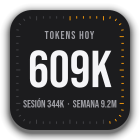

# Uso



Tarjeta flotante que muestra cuánto llevás gastado de tu plan de Claude, estilo widget de iOS: cuadrado redondeado, número grande en Bebas Neue y 60 marquitas en el borde que se pintan a medida que avanza la ventana de tiempo.

> Proyecto no oficial, sin relación con Anthropic. Usa un endpoint de uso que **no está documentado** y puede cambiar sin aviso (ver [Cómo obtiene los datos](#cómo-obtiene-los-datos)).

## Qué muestra

Un clic sobre el número pasa a la siguiente lectura:

| Lectura | Número grande | Marquitas | Pie |
|---|---|---|---|
| **Sesión 5H** | % usado de la sesión de 5 horas | tiempo transcurrido de la ventana de 5 h | % semanal · tokens de hoy |
| **Semana** | % usado de la semana | tiempo transcurrido de los 7 días | % de sesión · tokens de hoy |
| **Tokens hoy** | tokens de hoy | avance del día | tokens de la sesión · de la semana |

El ícono de la ventana (dock, barra de tareas, minimizada) es la propia tarjeta y se actualiza con ella.

## Requisitos

- Linux con Python 3.10+ y [Claude Code](https://claude.com/claude-code) instalado **y con sesión iniciada** (la app usa esa sesión; no pide usuario ni contraseña).
- PySide6 (ver `requirements.txt`).

## Uso

```bash
python3 -m venv .venv
.venv/bin/pip install -r requirements.txt
./usage.sh
```

Parámetros (valen solo para esa vez):

```
./usage.sh --sesion | --semana | --tokens   # lectura inicial
./usage.sh --tema N                         # color, de 0 a 4
./usage.sh --captura RUTA                   # guarda una imagen y sale
```

### Controles

- **Clic** sobre el número: siguiente lectura. Se recuerda al volver a abrir.
- **Arrastrar** (clic izquierdo, fuera del número, o desde el número moviendo el mouse): mover la ventana.
- **Clic derecho**: menú con la versión, **Actualizar**, **Color** (5 combinaciones: Clásico, Noche, Océano, Menta, Violeta), **Actualizar cada** (1, 2, 5 o 10 min; por defecto 2) y **Cerrar**.
- **Esc**: cerrar.

## Cómo obtiene los datos

Hay dos fuentes, las dos locales a tu cuenta:

1. **Porcentajes (sesión y semana).** Lee el token OAuth de Claude Code en `~/.claude/.credentials.json` y consulta `https://api.anthropic.com/api/oauth/usage` (el mismo dato que ve Claude Code). El token se envía solo a ese host. Respeta `CLAUDE_CONFIG_DIR` si usás otra carpeta de configuración. Como el endpoint no es público, si Anthropic lo cambia dejará de funcionar y la tarjeta pasa al modo estimado.
2. **Tokens.** Suma `input + output + creación de caché` de los registros `~/.claude/projects/**/*.jsonl` (la lectura de caché no se cuenta). Solo incluye lo que hiciste en **esa máquina**; el uso desde la web, la app o otra PC cuenta en los porcentajes pero no en los tokens.

**Si la API no responde** (sin red, token vencido, `429 rate limited`) los porcentajes se **estiman** y se muestran con `~` (por ejemplo `~13%`), a partir de los tokens locales y de cuántos tokens equivalían a 1 % en la última lectura buena (se guarda en `~/.config/uso-claude/cache.json`). Es aproximado, porque no todos los tokens pesan igual en el límite. Si nunca hubo una lectura buena, se muestran tokens. Tras un `429` espera 10 minutos antes de reintentar. El token lo renueva Claude Code: si hace días que no lo abrís puede estar vencido.

## Configuración

`~/.config/uso-claude/config.json` (respeta `XDG_CONFIG_HOME`) guarda la lectura, el color y el intervalo, por ejemplo `{"modo": "semana", "tema": 1, "cada": 5}`. `cache.json`, en la misma carpeta, guarda la calibración para las estimaciones.

## AppImage

Un solo archivo que no necesita instalar nada:

```bash
chmod +x Uso-x86_64.AppImage
./Uso-x86_64.AppImage
```

Para generarlo (PyInstaller + [appimagetool](https://github.com/AppImage/appimagetool), que se baja solo a `.cache/` la primera vez):

```bash
./build-appimage.sh
```

Se compila en la máquina donde se corre, así que el AppImage resultante pide una glibc igual de nueva que la de esa máquina. El script empaqueta `libssl`/`libcrypto` desde `/lib/x86_64-linux-gnu/` (Debian/Ubuntu); en otras distros ajustá esa ruta. Si el archivo está en uso, el build falla con `Text file busy`: cerrá la tarjeta o pasá `SALIDA=otra/ruta.AppImage`.

## Notas técnicas

- Los 60 palitos se reparten por igual a lo largo del perímetro del rectángulo redondeado, arrancando arriba al centro y en sentido horario; los de cada 5 son más largos.
- La ventana se mueve con `startSystemMove()` (el compositor la arrastra), que es lo que hace falta en Wayland, donde `move()` no funciona; si no está disponible, cae a un arrastre manual.
- Los datos se calculan en un hilo aparte para no trabar la interfaz. Los registros ya leídos se guardan en memoria por archivo (fecha y tamaño) y los mensajes repetidos entre sesiones se descuentan una sola vez.
- El menú del clic derecho es un `QMenu` sin marco y con fondo transparente para que se vean las esquinas redondeadas.

## Créditos

Tipografía: [Bebas Neue](https://fonts.google.com/specimen/Bebas+Neue) (SIL Open Font License).

## Licencia

[GPL-3.0](LICENSE). La tipografía Bebas Neue conserva su propia licencia (SIL OFL).
